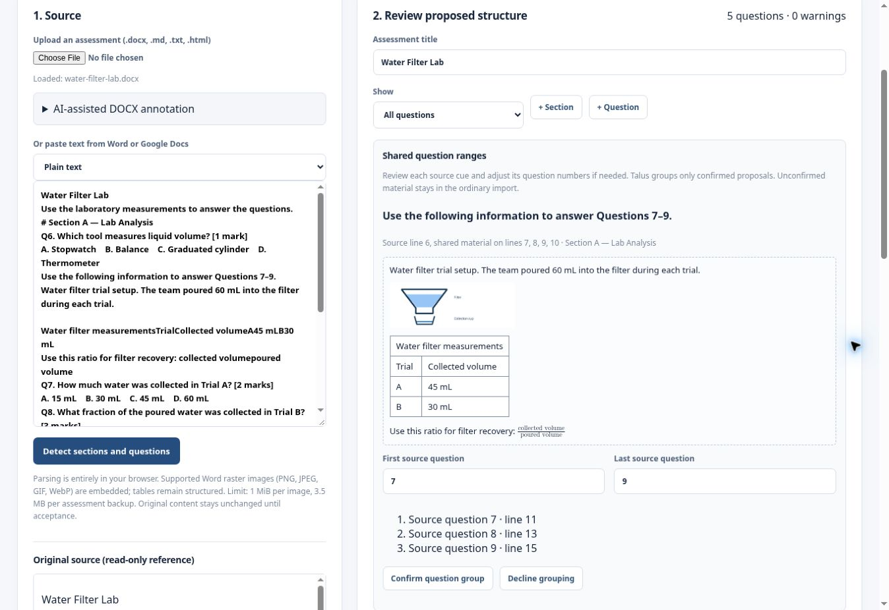
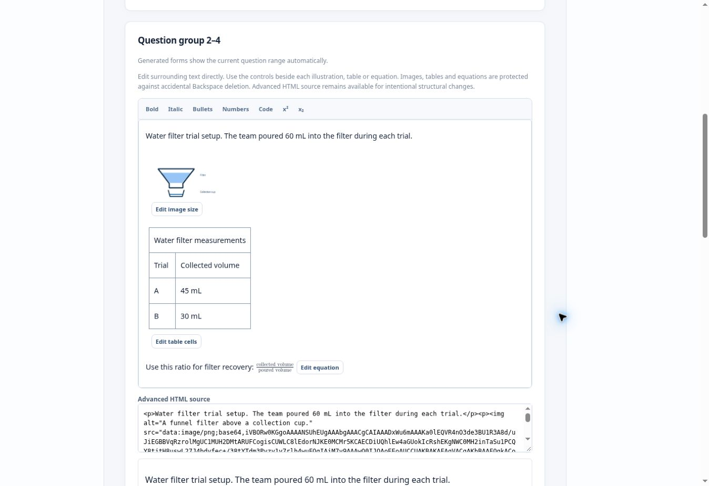
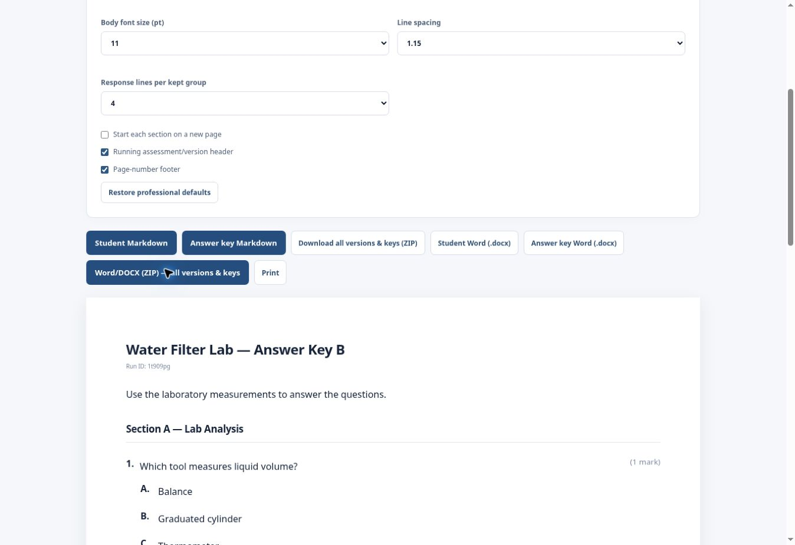

# Talus Test Versioner

Make several versions of one classroom assessment, with a matching answer key for each. Start with a test you wrote in Word or Google Docs, review how Talus interpreted it, then download editable Word files to polish and print. Talus runs in your browser and saves your working assessment on that device.

**[Open Talus](https://ccheng.github.io/talus1/)** · **[Download the sample Word assessment](docs/teacher/water-filter-lab.docx?raw=true)**

[Import an existing test](#1-import-an-existing-test) · [Keep questions with a shared reading or diagram](#2-keep-questions-with-a-shared-reading-or-diagram) · [Make and export versions](#3-make-and-export-versions) · [Back up and reuse a test](#back-up-and-reuse-a-test)

## 1. Import an existing test

1. Choose **Import assessment** and upload your Word `.docx`. In Google Docs, use **File → Download → Microsoft Word (.docx)** first. Use a file upload when your test has a table, diagram, or equation. For a quick text-only import, paste into the source box and choose **Detect sections and questions**.
2. In **Review proposed structure**, compare the proposed sections and questions with **Original source**. Open each question to check its type, marks, choices, and correct answer or reference answer. Fix any split or merged questions and review the warnings. If you see a line of underscores in a written-response prompt, remove it if you want to use the response space Talus adds.
3. If the review shows **Shared question ranges**, confirm only the ranges that match the source. When the review is complete, choose **Accept reviewed import**. If you're replacing a test you want to keep, download **Backup JSON** first.

*The sample uses source numbers 7–9 for its shared lab questions. Talus uses those numbers to identify the group and renumbers the questions in each generated form.*

## 2. Keep questions with a shared reading or diagram

If Talus detected a group during import, select one of its questions in **1. Author** to review the group and its shared material. To create a group yourself, select the first question in a consecutive set within a section, pick the last one under **Group through question**, then click **Group questions**. Add or edit the material in **Shared group material**.

The group stays together when the section shuffles. Leave **Shuffle questions within this group** off when students need to answer the questions in sequence. Talus updates the displayed range on each form, so keep the shared material free of hard-coded question numbers.

## 3. Make and export versions

1. In **1. Author**, set question shuffling for each section and answer-choice shuffling for each applicable question. Section order stays fixed. To rotate between equivalent prompts, use **+ Copy alternative** on a question and edit the copy. Each form uses one alternative per question.
2. Under **Generate versions**, set the **Number of versions**, resolve any validation messages, and click **Generate**. To reproduce a run, keep the same assessment, version count, and **Reproducibility seed**.
3. In **2. Versions & answer keys**, pick a **Version** and toggle **Answer key** to inspect its matching key. Use **Student Word (.docx)** or **Answer key Word (.docx)** for that version. Choose **Word/DOCX (ZIP) — all versions & keys** for the whole set. Three versions produce six editable Word documents plus a generation manifest.
4. Adjust **Word layout & pagination** if you need different margins, spacing, or page size. Open the downloaded student forms and keys in Word, or upload the DOCX files to Google Drive to edit in Google Docs. Check page breaks and response space in the editor you'll print from.

## Keep a record of the shuffle

Select a version in **Versions & answer keys** and choose **Download receipt (PDF)**. The teacher copy lists the original reviewed section and question, the selected alternative, the version's question number, and how each choice letter moved. The **Key** column shows the correct letters in the generated version.

To verify an exact Word export later, download the student form, key, or Word ZIP first. Then choose **Download receipt (JSON)** for that version and keep it with the export. Use **Verify a Word export** to select the saved JSON and the individual DOCX file. Renaming a file still matches. Editing and saving in Word can change the file's bytes, so keep the unedited export if you need to verify it later. Exporting again replaces the recorded fingerprint for that file type in new receipts.

Talus hides marks beside questions by default. Turn on **Show marks beside questions** in **Versions & answer keys** to include them in the preview, browser print, and Word and Markdown exports for students and answer keys. The switch saves with your test. You can toggle it and export again without regenerating versions.

## Back up and reuse a test

- **Backup JSON** saves an editable Talus project. Keep it alongside the source Word file and exported versions. Use **Import JSON** to reopen it in Talus or move it to another browser. Clearing browser data can erase the local working copy.
- **New test** starts an assessment in Talus. Add a title and instructions, then use **+ Question** to build each section. For multiple choice, enter the choices and mark the correct answer before generating.

## For contributors

[Development handoff](docs/HANDOFF.md) · [Milestone and roadmap notes](docs/MILESTONES.md) · [Quality gate](docs/QUALITY_GATE.md) · [AI import design](docs/MILESTONE_2D.md) · [Development history](docs/DEVELOPMENT_HISTORY.md)
